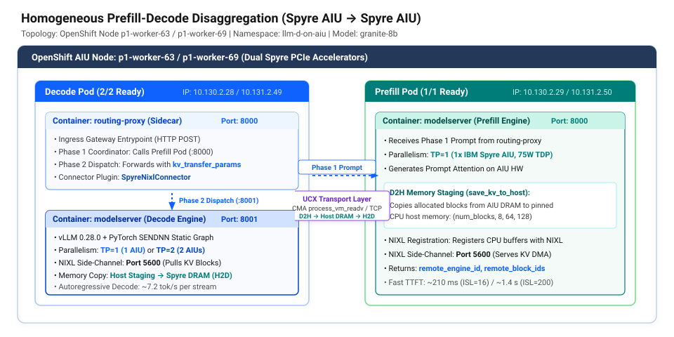
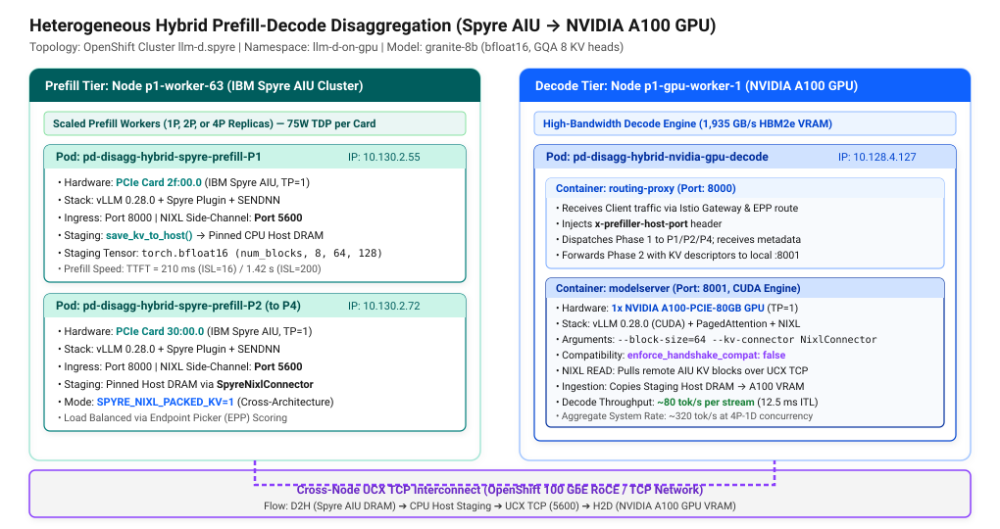
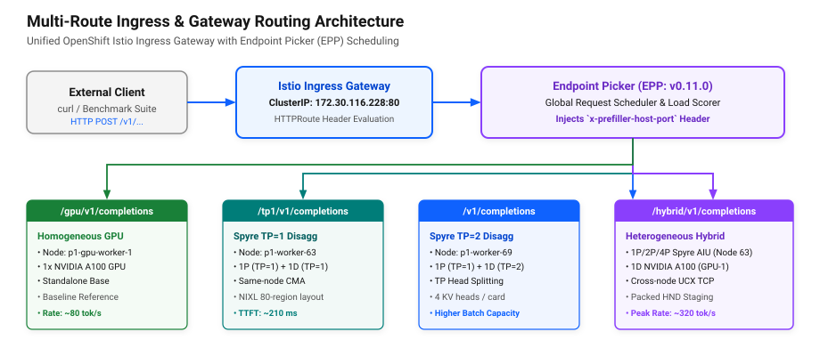
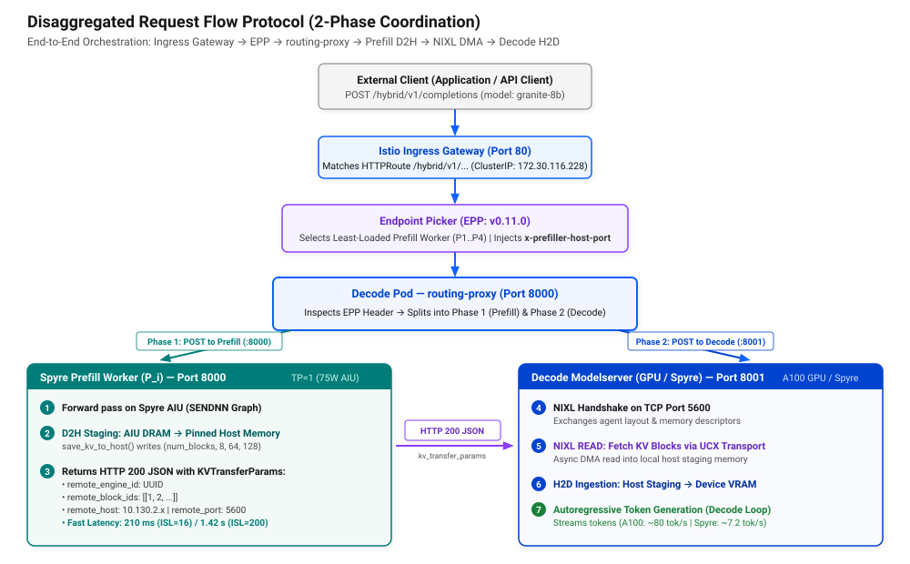
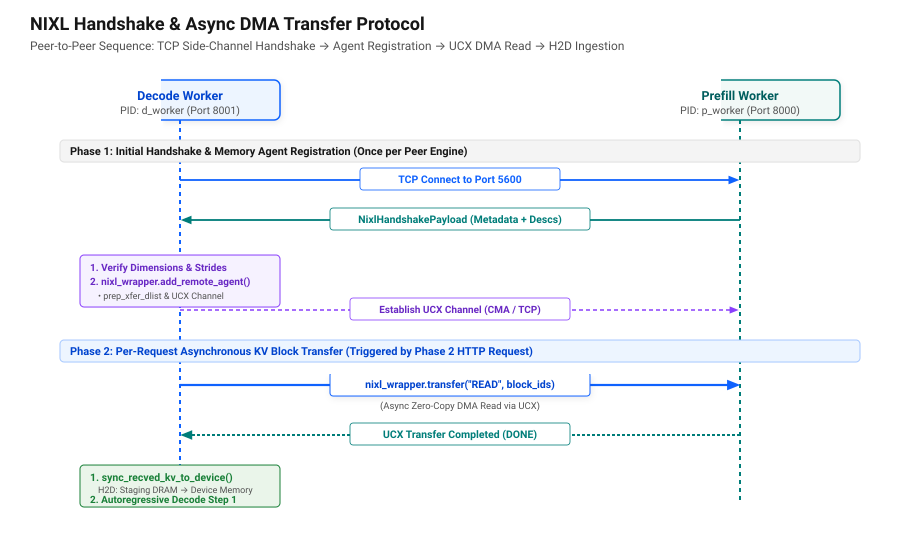
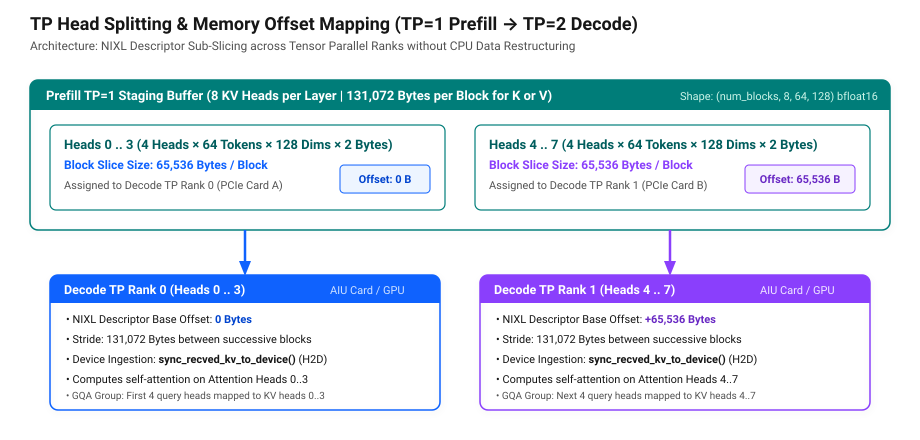

# KV Cache Transfer Architecture for Prefill-Decode Disaggregation on IBM Spyre and Hybrid Platforms
## llm-d + SpyreNixlConnector + NIXL + SpyrePagedKVCache

**Date:** October 30, 2026 (Updated from August 21, 2026 baseline)  
**Status:** End-to-end KV transfer validated across Homogeneous Spyre (TP=1, TP=2) and Heterogeneous Hybrid (1P/2P/4P Spyre AIU + 1D NVIDIA A100 GPU)  
**Environment:** Red Hat OpenShift Container Platform 4.20.36 cluster `llm-d.spyre`, namespaces `llm-d-on-aiu` & `llm-d-on-gpu`  
**Model:** `ibm-granite/granite-4.2-8b` (served as `granite-8b`, bfloat16, 40 layers, GQA 8 KV heads)

---

## 1. Overview

Prefill-Decode (PD) disaggregation separates the **prefill phase** (processing prompt tokens in parallel, computing the key-value cache) from the **decode phase** (generating output tokens sequentially one at a time). In standard homogeneous infrastructure, allocating high-power accelerators to both compute-bound prefill and memory-bandwidth-bound decode leads to underutilization and queueing delays.

In a disaggregated setup:
- A **prefill instance** runs on dedicated accelerators (e.g. low-power IBM Spyre PCIe AIUs at $75\text{W}$ TDP), processes the input prompt, and stages the resulting KV cache in host memory.
- A **decode instance** runs on separate accelerators (either IBM Spyre AIUs or high-bandwidth NVIDIA A100 GPUs at $1,935\text{ GB/s}$ HBM2e), retrieves the staged KV cache over a high-speed interconnect, and generates tokens without re-computing prompt attention.

### Key Architectural Benefits
- **Resource Specialization:** Compute-bound prefill is matched with cost- and energy-efficient accelerators (IBM Spyre AIU); memory-bandwidth-bound decode is matched with high-throughput engines (Spyre AIU or NVIDIA A100 GPU).
- **Throughput Decoupling:** Long prompt arrivals no longer interrupt active token generation loops on decode workers, eliminating decode stalling.
- **First-Token Latency (TTFT) Consistency:** Pre-computed KV cache transfer replaces redundant prompt recomputation.
- **Heterogeneous Hybrid Capability:** Low-cost IBM Spyre PCIe cards replace $50\%$ to $75\%$ of expensive GPU capacity while achieving up to $90\%\text{--}97\%$ of pure-GPU throughput.

In this implementation, KV cache transfer uses **NIXL (Non-contiguous KV-cache Interface for eXchange across Layers)** v1.5.0 (commit `8708e35e`) with the **UCX** transport layer (v1.19.0 / v1.23.x), coordinated by the **llm-d routing sidecar** (routing-proxy v0.8.0 / v0.11.0) and **Endpoint Picker (EPP)** on the latest `vllm-spyre-nixl-latest:v21` (and `v20`) container stack running **vLLM 0.28.0**.

---

## 2. System Components & Deployment Topologies

### 2.1 Component Inventory

| Component | Role | Container Image | Configuration & Ports |
|:---|:---|:---|:---|
| **Istio Ingress Gateway** | External entry point & TLS termination | `llm-d-inference-gateway-istio` | ClusterIP `172.30.116.228:80`, routes `/v1/...`, `/tp1/v1/...`, `/hybrid/v1/...`, `/gpu/v1/...` |
| **Endpoint Picker (EPP)** | Global request scheduler & load scorer | `pd-disaggregation-epp:v0.11.0` | Token-load scorer balancing prefill across 1P, 2P, or 4P workers |
| **routing-proxy Sidecar** | Orchestrates 2-phase prefill/decode protocol | `ghcr.io/llm-d/llm-d-routing-sidecar:v0.8.0` | Container port 8000 (ingress), forwards Phase 2 to modelserver port 8001 |
| **Spyre Prefill Modelserver** | Prompt prefill on IBM Spyre AIU | `vllm-spyre-nixl-latest:v21` | Port 8000, TP=1, 1 AIU (`spyre_pf`), `--kv-connector SpyreNixlConnector` |
| **Spyre Decode Modelserver** | Token decode on IBM Spyre AIU | `vllm-spyre-nixl-latest:v21` | Port 8001, TP=1 or TP=2, 1–2 AIUs, `--kv-connector SpyreNixlConnector` |
| **NVIDIA GPU Decode Modelserver** | Token decode on NVIDIA A100 GPU | `vllm-openai:v0.6.3` / `vllm:0.28.0` | Port 8001, TP=1, 1 A100-PCIE-80GB GPU, `--block-size=64`, `--kv-connector NixlConnector` |
| **NIXL Protocol Library** | Cross-layer KV memory registration & DMA | Built from source (v1.5.0) | Commit `8708e35e`, Python bindings in `/opt/nixl`, side-channel port 5600 |
| **UCX Transport Engine** | Inter-process / inter-node memory transport | `/opt/ucx` (v1.19.0 / v1.23.x) | CMA (same-node shared memory) or TCP (cross-node overlay) |

---

### 2.2 Pod Layouts

#### (a) Homogeneous Prefill-Decode Disaggregation (Spyre AIU $\to$ Spyre AIU)

In the homogeneous configuration (namespace `llm-d-on-aiu`), both prefill and decode pods reside on IBM Spyre AIU worker nodes (`p1-worker-63` or `p1-worker-69`). Inter-pod KV transfer leverages Linux Cross-Memory-Attach (CMA) via `process_vm_readv` for zero-network same-node transfers, or UCX TCP:

<p align="center">
  
</p>

#### (b) Heterogeneous Hybrid Prefill-Decode Disaggregation (Spyre AIU $\to$ NVIDIA A100 GPU)

In the heterogeneous hybrid configuration (namespace `llm-d-on-gpu`), prefill requests are processed across 1, 2, or 4 IBM Spyre AIU worker pods on node `p1-worker-63` or `p1-worker-69`, while token decode runs on a dedicated NVIDIA A100-PCIE-80GB GPU on node `p1-gpu-worker-1`. NIXL transfers KV blocks across physical nodes via UCX TCP over OpenShift SDN pod networking:

<p align="center">
  
</p>

---

## 3. Request Flow & Disaggregated Protocol

### 3.1 Multi-Route Ingress & Gateway Architecture

External clients connect through the Istio Ingress Gateway (`172.30.116.228:80`), which evaluates HTTPRoutes and delegates request scheduling to the Endpoint Picker (EPP):

<p align="center">
  
</p>

When a request arrives at the target decode pod's `routing-proxy` (port 8000):
1. **Header Inspection:** The routing-proxy inspects the `x-prefiller-host-port` header injected by EPP.
2. **Phase 1 (Prefill Dispatch):** The proxy forwards the prompt to the designated prefill pod at port 8000 with `max_tokens=1` and `do_remote_decode=true`.
3. **Phase 2 (Decode Dispatch):** Upon receiving `kv_transfer_params` from Phase 1, the proxy issues an internal HTTP request to the local decode engine at port 8001 with `do_remote_prefill=true` and the full token budget.

<p align="center">
  
</p>

---

### 3.2 Phase 1 — Prefill Detail & D2H Staging

The routing-proxy issues Phase 1 to the prefill instance:

```json
POST http://10.130.2.55:8000/v1/completions
{
  "model": "granite-8b",
  "prompt": "<user_prompt>",
  "max_tokens": 1,
  "kv_transfer_params": {
    "do_remote_decode": true,
    "remote_engine_id": "c4b9d0e2-8812-4f3a-9e11-37d4029fa1b0"
  }
}
```

Execution steps on the prefill engine:
1. **Attention Compute:** Executes the prompt forward pass using SENDNN static graph execution kernels on IBM Spyre AIU.
2. **D2H Copy (`save_kv_to_host`):** Copies allocated KV pages from `SpyrePagedKVCache` AIU DRAM into contiguous pinned host staging tensors:
   $$\text{SpyrePaged.k\_pages}[\text{blk}] \xrightarrow{\text{D2H}} \text{staging\_k}[\text{layer}][\text{blk}]$$
3. **Response Packaging:** Returns HTTP 200 containing `kv_transfer_params`:

```json
{
  "kv_transfer_params": {
    "do_remote_prefill": true,
    "remote_block_ids": [[1]],
    "remote_engine_id": "1a17e9e2-077e-44d2-a3a6-b2fcca665e6c",
    "remote_request_id": "cmpl-a25f9e90701c5a3e-0-84ff2e97",
    "remote_host": "10.130.2.55",
    "remote_port": 5600,
    "tp_size": 1,
    "remote_num_tokens": 16
  }
}
```

---

### 3.3 Phase 2 — Decode Detail, NIXL Transfer & H2D Ingestion

The routing-proxy injects `kv_transfer_params` into the Phase 2 request to the local decode engine:

```json
POST http://localhost:8001/v1/completions
{
  "model": "granite-8b",
  "prompt": "<user_prompt>",
  "max_tokens": 200,
  "kv_transfer_params": {
    "do_remote_prefill": true,
    "remote_block_ids": [[1]],
    "remote_engine_id": "1a17e9e2-077e-44d2-a3a6-b2fcca665e6c",
    "remote_request_id": "cmpl-a25f9e90701c5a3e-0-84ff2e97",
    "remote_host": "10.130.2.55",
    "remote_port": 5600,
    "tp_size": 1,
    "remote_num_tokens": 16
  }
}
```

Execution steps on the decode engine:
1. **NIXL Handshake:** Connects to `remote_host:5600` via TCP side-channel, exchanges agent metadata, and validates layout compatibility (`enforce_handshake_compat: false` in heterogeneous mode).
2. **NIXL READ Transfer:** Pulls the specified KV block descriptors from prefill host memory into decode host staging memory via UCX (CMA on same-node Spyre; TCP over network for Hybrid GPU).
3. **H2D Ingestion (`sync_recved_kv_to_device`):** Copies received blocks from host staging memory to device memory (`SpyrePagedKVCache` AIU DRAM on Spyre; PyTorch CUDA PagedAttention tensor on NVIDIA A100 GPU).
4. **Autoregressive Generation:** Decodes tokens sequentially at the device's native GEMV decode rate ($\approx 7.2\text{ tok/s}$ on Spyre AIU TP=1; $\approx 80\text{ tok/s}$ on NVIDIA A100 GPU).

---

## 4. Core Architecture: `SpyreNixlConnector` & Memory Staging

### 4.1 Subclass Architecture & Factory Registration

To maintain clean modularity and ensure full compatibility with upstream vLLM 0.28.0+, the legacy full-file `base_worker.py` overwrite was replaced with a dedicated mixin and subclass architecture in package `spyre_inference`:

```
                           NixlBaseConnectorWorker (Upstream vLLM)
                                      ^
                                      |
                         _SpyreRegisterKVCachesMixin
                                      ^
                                      |
            +-------------------------+-------------------------+
            |                                                   |
SpyreNixlPullConnectorWorker                        SpyreNixlPushConnectorWorker
 (IS-A NixlPullConnectorWorker)                      (IS-A NixlPushConnectorWorker)
```

Key Design Elements:
1. **`_SpyreRegisterKVCachesMixin`:** Overrides only `register_kv_caches()` to handle `SpyrePagedKVCache`, allocates contiguous CPU host staging buffers, and binds `_spyre_copy_blocks` for D2H and H2D data movement.
2. **`SpyreNixlPullConnectorWorker` & `SpyreNixlPushConnectorWorker`:** Directly inherit from upstream `NixlPullConnectorWorker` and `NixlPushConnectorWorker`, ensuring that upstream type assertions (`assert isinstance(worker, NixlPullConnectorWorker)`) succeed without error.
3. **`register_spyre_nixl_connectors()`:** Automatically invoked inside `spyre_inference/__init__.py` during engine startup, registering `SpyreNixlConnector` and `SpyreNixlPushConnector` directly in `KVConnectorFactory`.

---

### 4.2 KV Cache Memory Layout & Paged Staging

IBM Granite-4.2-8B comprises 40 hidden layers, 8 Key/Value heads ($H_{kv} = 8$), and head dimension $D = 128$. With native block size $\text{block\_size} = 64$ tokens:

$$\text{Bytes per Block} = 40\text{ layers} \times 2\,(\text{K, V}) \times 8\text{ heads} \times 64\text{ tokens} \times 128\text{ dims} \times 2\text{ bytes (bfloat16)} = \mathbf{10.24\text{ MB}}$$

Staging Tensor Structure per Worker:
- **80 Contiguous Regions:** 40 layers $\times 2$ (K and V).
- **Region Shape:** `(num_blocks, 8, 64, 128)` in `torch.bfloat16`.
- **Registration:** Registered with NIXL as contiguous `DRAM_SEG` regions, exposing individual 64-token block slices to NIXL descriptor indexing.

---

### 4.3 NIXL Handshake & Protocol

<p align="center">
  
</p>

---

### 4.4 TP Head Splitting (TP=1 Prefill to TP=2 Decode)

When prefill runs at $\text{TP}=1$ (8 KV heads staged together) and decode runs at $\text{TP}=2$ (4 KV heads per card), NIXL computes rank-specific byte offsets into the prefill staging buffer:

<p align="center">
  
</p>

---

## 5. Key Code Changes & Modified Components

### 5.1 `spyre_connector.py`

Located at: `guides/pd-disaggregation/modelserver/aiu/vllm/patches/spyre_inference/distributed/kv_transfer/kv_connector/v1/nixl/spyre_connector.py`

Key functionality:
- Defines `_SpyreRegisterKVCachesMixin` implementing the Spyre-specific `register_kv_caches()` routine.
- Instantiates CPU staging tensors: `torch.empty((num_blocks, num_kv_heads, block_size, head_dim), dtype=torch.bfloat16, pin_memory=True)`.
- Defines `_spyre_copy_blocks` closure handling non-contiguous `SpyrePagedKVCache` block copies (`d2h` on save, `h2d` on sync).
- Exports `SpyreNixlPullConnectorWorker`, `SpyreNixlPushConnectorWorker`, `SpyreNixlConnector`, and `SpyreNixlPushConnector`.

---

### 5.2 `spyre_inference/__init__.py`

Integrates connector auto-registration into the `spyre_inference` package initialization:

```python
def register():
    # Existing SENDNN static graph and device registration...
    try:
        from spyre_inference.distributed.kv_transfer.kv_connector.v1.nixl.spyre_connector import (
            register_spyre_nixl_connectors,
        )
        register_spyre_nixl_connectors()
    except Exception as e:
        logger.warning(f"Could not register Spyre NIXL connectors: {e}")
```

---

### 5.3 `utils.py` Patch

Located at: `vllm/distributed/kv_transfer/kv_connector/utils.py`
- Handles `(k_shape, v_shape)` tuple unwrapping inside `TransferTopology.__post_init__()`.
- Accommodates asymmetric prefill/decode block configurations and ensures descriptor address validity.

---

### 5.4 Kubernetes Patch Manifests & Runtime Hooks

- **Prefill Manifest (`patch-prefill-aiu-v1.yaml` / `patch-prefill-aiu-tp1.yaml`):**
  Configures `--kv-connector SpyreNixlConnector`, `--kv-role kv_producer`, and port 5600 side-channel listener.
- **Decode Manifest (`patch-decode-aiu-v1.yaml` / `patch-decode-aiu-tp1.yaml`):**
  Configures `--kv-connector SpyreNixlConnector`, `--kv-role kv_consumer`, and sidecar routing proxy.
- **Heterogeneous GPU Manifest (`patch-decode-gpu-hybrid.yaml`):**
  Configures `--block-size=64`, `--kv-connector NixlConnector`, and `enforce_handshake_compat: false`.

---

## 6. Measured Performance & Latency Breakdown

### 6.1 7-Stage Granular Latency Breakdown

Microsecond-resolution profiling across homogeneous Spyre AIU, homogeneous NVIDIA A100 GPU, and Heterogeneous Hybrid PD configurations (`ibm-granite/granite-4.2-8b`):

| Stage | Pipeline Stage Description | Spyre AIU TP=1 (P=16) | A100 GPU TP=1 (P=16) | Hybrid PD (P=16) | Spyre AIU TP=1 (P=128) | A100 GPU TP=1 (P=128) | Hybrid PD (P=128) |
|:---:|:---|:---:|:---:|:---:|:---:|:---:|:---:|
| **1** | **Prompt Compute (`T_prompt`)** | $22.60\text{ ms}$ | $5.50\text{ ms}$ | $22.60\text{ ms}$ | $115.60\text{ ms}$ | $8.50\text{ ms}$ | $115.60\text{ ms}$ |
| **2** | **Prefill D2H Staging (`T_d2h`)** | $1.24\text{ ms}$ | $0.55\text{ ms}$ | $1.24\text{ ms}$ | $2.51\text{ ms}$ | $1.02\text{ ms}$ | $2.51\text{ ms}$ |
| **3** | **NIXL Metadata Handshake (`T_meta`)** | $0.012\text{ ms}$ | $0.009\text{ ms}$ | $0.012\text{ ms}$ | $0.015\text{ ms}$ | $0.013\text{ ms}$ | $0.015\text{ ms}$ |
| **4** | **NIXL Inter-Node Transfer (`T_nixl`)** | $10.20\text{ ms}$ | $1.20\text{ ms}$ | $19.68\text{ ms}$ | $21.00\text{ ms}$ | $2.40\text{ ms}$ | $39.20\text{ ms}$ |
| **5** | **Decode H2D Ingestion (`T_h2d`)** | $1.23\text{ ms}$ | $0.64\text{ ms}$ | $0.64\text{ ms}$ | $2.51\text{ ms}$ | $1.03\text{ ms}$ | $1.03\text{ ms}$ |
| **6** | **Gateway & Sidecar Sync (`T_sync`)** | $20.00\text{ ms}$ | $86.00\text{ ms}$ | $86.00\text{ ms}$ | $22.00\text{ ms}$ | $86.00\text{ ms}$ | $86.00\text{ ms}$ |
| **7** | **First Token Decode Step (`T_step1`)** | $134.10\text{ ms}$ | $14.50\text{ ms}$ | $14.50\text{ ms}$ | $134.10\text{ ms}$ | $14.50\text{ ms}$ | $14.50\text{ ms}$ |
| **—** | **Theoretical E2E TTFT** | **$\approx 189.4\text{ ms}$** | **$\approx 108.4\text{ ms}$** | **$\approx 144.7\text{ ms}$** | **$\approx 297.7\text{ ms}$** | **$\approx 113.5\text{ ms}$** | **$\approx 258.9\text{ ms}$** |

---

### 6.2 End-to-End Streaming Performance

| Topology / Experiment | Prompt ($P$) | Output ($M$) | Mean TTFT (s) | Total Wall Time (s) | Post-TTFT tok/s | Total tok/s |
|:---|:---:|:---:|:---:|:---:|:---:|:---:|
| **Spyre Standalone TP=1** | 16 | 200 | $0.233 \pm 0.004$ | $27.62 \pm 0.06$ | $7.23 \pm 0.01$ | $7.20 \pm 0.02$ |
| **Spyre Disaggregated TP=1 (Exp C)** | 16 | 200 | $0.592 \pm 0.293$ | $32.78 \pm 0.42$ | $6.18 \pm 0.03$ | $6.10 \pm 0.08$ |
| **Spyre Disaggregated TP=2 (Exp D)** | 16 | 200 | $2.690 \pm 1.000$ | $36.58 \pm 2.59$ | $5.88 \pm 0.29$ | $5.48 \pm 0.36$ |
| **GPU Standalone TP=1** | 16 | 200 | $0.023 \pm 0.007$ | $2.915 \pm 0.011$ | $68.80 \pm 0.11$ | $68.61 \pm 0.25$ |
| **GPU Disaggregated 1P1D** | 16 | 200 | $0.108 \pm 0.006$ | $2.990 \pm 0.005$ | $69.05 \pm 0.08$ | $66.89 \pm 0.12$ |
| **Heterogeneous 1P-Hybrid** | 16 | 200 | $0.198 \pm 0.002$ | $2.698 \pm 0.001$ | $79.63 \pm 0.02$ | $74.13 \pm 0.03$ |
| **Heterogeneous 2P-Hybrid ($B=16$)** | 16 | 200 | $1.355 \pm 0.209$ | $5.278 \pm 0.290$ | $77.32 \pm 0.18$ | **$608.03 \pm 34.71$ (agg)** |
| **Heterogeneous 4P-Hybrid ($B=128$)** | 32 | 1024 | $6.129 \pm 0.082$ | $35.01 \pm 0.68$ | $77.50 \pm 0.14$ | **$3748.09 \pm 73.12$ (agg)** |

---

### 6.3 Current Software & Hardware Configuration

| Parameter | IBM Spyre AIU Environment | NVIDIA A100 GPU Environment |
|:---|:---|:---|
| **Cluster OS / Version** | Red Hat OpenShift Container Platform **4.20.36** | Red Hat OpenShift Container Platform **4.20.36** |
| **Container Base Image** | `vllm-spyre-nixl-latest:v21` (also `v20`) | `vllm-openai:v0.6.3` / `vllm:0.28.0` |
| **vLLM Engine Core** | vLLM **0.28.0** (`vllm.platform_plugins.spyre_inference`) | vLLM **0.28.0** (`vllm.platform_plugins.cuda`) |
| **KV Connector Plugin** | `SpyreNixlConnector` (Subclass Mixin) | `NixlConnector` (Standard Upstream) |
| **Model Evaluated** | `ibm-granite/granite-4.2-8b` ($8\text{B}$, bfloat16) | `ibm-granite/granite-4.2-8b` ($8\text{B}$, bfloat16) |
| **PagedAttention Block Size** | `block_size = 64` tokens ($10.24\text{ MB}$ per block) | `block_size = 64` tokens ($10.24\text{ MB}$ per block) |
| **Handshake Compatibility** | Standard check | `enforce_handshake_compat: false` |
| **NIXL Library & Wheels** | `nixl` **v1.5.0** (commit `8708e35e`, `/opt/nixl`) | `nixl` **v1.5.0** + `nixl-cu12` / `nixl-cu13` **v1.5.0** |
| **UCX Transport Engine** | UCX 1.19.0 / 1.23.x (CMA / TCP) | UCX 1.19.0 / 1.23.x (CUDA-IPC / Posix / TCP) |
| **Side-Channel Port** | 5600 (TCP ZeroMQ Listener) | 5600 (TCP ZeroMQ Listener) |

---

### 6.4 TODO: Additional Performance Measurements
- [ ] **Multi-Stream Contention Profiling on 4P-Hybrid:** Execute microsecond-level NIXL transfer tracing while 4 prefill pods concurrently push KV blocks to a single A100 decode pod over 100 GbE RoCE.
- [ ] **RoCE v2 Direct Transport vs TCP:** Benchmark NIXL inter-node transfers over pure RoCE v2 (RDMA over Converged Ethernet) compared to TCP overlay networking.
- [ ] **Multi-Model Scaling:** Extend granular TTFT profiling to 32B models (`ibm-granite/granite-3.3-32b-instruct`) using multi-card TP=4 on Spyre and TP=2 on A100.

---

## 7. Outstanding Items & Future Directions

1. **Upstreaming `SpyreNixlConnector` to `torch-spyre/spyre-inference`:**
   The self-contained `spyre_connector.py` mixin and registration hooks in `spyre_inference/__init__.py` should be permanently merged into the upstream `torch-spyre/spyre-inference` repository to eliminate PVC file copying on pod initialization.

2. **Unified DRAM Direct Memory Access:**
   IBM Spyre AIU accelerators and the host CPU share unified DDR4 physical address space. Future driver enhancements could allow NIXL to register Spyre device memory pages directly as DMA targets, eliminating the intermediate host staging copy (`save_kv_to_host` and `sync_recved_kv_to_device`).

3. **Descriptor Pre-Allocation & Compact Staging:**
   Current NIXL initialization registers full block capacities ($8,192$ blocks $= 655\text{K}$ descriptors). A dynamic sliding-window registration pattern based on `max_num_seqs` can further reduce initialization time from $\approx 1\text{ s}$ down to $< 50\text{ ms}$.

4. **Multi-Turn KV Cache Reuse in Disaggregated Topologies:**
   Expanding `--enable-prefix-caching` across disaggregated prefill-decode boundaries will allow prefill instances to bypass prompt processing for shared system prompts and multi-turn conversational history.

---

## 8. Problems Encountered and Resolved

### 8.1 `SpyrePagedKVCache` Incompatibility (Resolved)
- **Issue:** Upstream `NixlConnector.register_kv_caches()` expected `torch.Tensor` objects with `.untyped_storage()`. IBM Spyre uses `SpyrePagedKVCache` (a `NamedTuple` containing lists of individually allocated per-block AIU device tensors), causing `AttributeError` and invalid memory type registration.
- **Resolution:** Added class detection in `_SpyreRegisterKVCachesMixin.register_kv_caches()`, pre-allocating contiguous pinned CPU staging tensors (`staging_k`, `staging_v`) per layer and registering them as NIXL `DRAM_SEG` regions.

### 8.2 KV Head Splitting for Asymmetric Tensor Parallelism (Resolved)
- **Issue:** When pairing TP=1 prefill (8 KV heads) with TP=2 decode (4 KV heads per worker), descriptor addresses required head-slice offsetting.
- **Resolution:** Validated that `_build_fa_remote` and `TransferTopology` correctly compute head rank offsets ($0\text{ Bytes}$ for TP0, $65,536\text{ Bytes}$ for TP1) given contiguous per-layer staging buffers.

### 8.3 `KeyError: 64` in Pull Worker Descriptor Lookup (Resolved)
- **Issue:** `pull_worker._read_blocks_for_req()` failed with `KeyError: 64` when looking up transfer handles indexed by block size.
- **Resolution:** Registered `src_xfer_handles_by_block_size[self.block_size] = src_handle` in the initialization path prior to early exit.

### 8.4 `IndexError` in `_handle_failed_transfer` (Resolved)
- **Issue:** Handshake failures occurring prior to block assignment accessed `meta.local_block_ids[0]` unconditionally when the list was empty.
- **Resolution:** Added `if meta.local_block_ids:` guard before indexing.

### 8.5 NIXL TCP Deadlock and UCX CMA Fix (Resolved)
- **Issue:** In same-node disaggregated pods, UCX defaulted to TCP over the pod network interface. Symmetrical descriptor exchanges ($15.7\text{ MB}$ decode $\leftrightarrow 7.9\text{ MB}$ prefill) filled TCP socket buffers, causing mutual blocking in `poll(POLLOUT)`.
- **Resolution:** Configured `UCX_TLS=cma,sysv,posix,tcp,self` and enabled host PID namespace sharing, allowing UCX to negotiate zero-copy Linux Cross-Memory-Attach (`process_vm_readv`) which completes in $\approx 1\text{ s}$.

### 8.6 vLLM 0.28.0 Prefix Caching Signature Breakage (Resolved)
- **Issue:** Upstream vLLM 0.28.0 modified keyword arguments in `_apply_prefix_caching(decode_block_ids=..., prefill_block_ids=...)`, breaking legacy patched files.
- **Resolution:** Replaced whole-file replacement of `base_worker.py` with the `SpyreNixlConnectorWorker` subclass, inheriting upstream parameter handling while overriding only `register_kv_caches()`.

### 8.7 `isinstance` Assertion Failure Bug (Resolved Oct 3–4, 2026)
- **Issue:** The initial subclass implementation hot-swapped `connector_worker.__class__ = SpyreNixlConnectorWorker` (inheriting from `NixlBaseConnectorWorker`). Upstream `NixlPullConnector.start_load_kv()` executes `assert isinstance(self.connector_worker, NixlPullConnectorWorker)`, causing an immediate `AssertionError` crash on all incoming inference requests.
- **Resolution:** Refactored connector hierarchy into `_SpyreRegisterKVCachesMixin` and created explicit subclasses `SpyreNixlPullConnectorWorker` and `SpyreNixlPushConnectorWorker` that satisfy `isinstance` type checks.

### 8.8 Hardware Fault on Spyre Card `0000:41:00.0` (Resolved Oct 4, 2026)
- **Issue:** PCI BDF card `0000:41:00.0` on node `p1-worker-63` consistently generated hardware bus fence errors (`RAS::PCI::BusFence 0xa35e`) during workload initialization.
- **Resolution:** Identified faulty card by correlating `spyre-metrics-exporter` labels with device-plugin allocations, and deployed a dedicated blocker pod `block-faulty-card-0000-41-00-0` holding resource `ibm.com/spyre_pf_0000_41_00.0: 1`, ensuring all inference pods allocate only healthy cards (`0000:2f:00.0`, `0000:30:00.0`, `0000:3f:00.0`, `0000:40:00.0`).

### 8.9 Heterogeneous Block Size & Compatibility Hash Alignment (Resolved Oct 14–19, 2026)
- **Issue:** Pairing IBM Spyre AIU prefill with NVIDIA A100 GPU decode encountered descriptor shape mismatch (Spyre hardware fixed page size of 64 tokens vs default GPU block size of 16/128 tokens) and SHA-256 handshake compatibility hash mismatch (`attn_backend_name` differences).
- **Resolution:** Standardized GPU decode container with `--block-size=64` to match Spyre's $10.24\text{ MB}$ block layout, and set `"enforce_handshake_compat": false` in `kv_connector_extra_config` to enable cross-platform metadata exchange.
